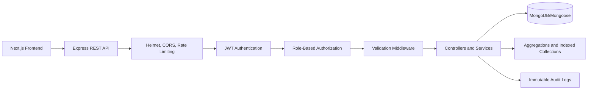

# Doctor Tracker Backend

## Description

Doctor Tracker is a secure, production-oriented REST API that enables separate Next.js frontend users to manage doctors, patients, dashboards, RBAC accounts, and immutable audit history. Built with Express.js and MongoDB/Mongoose, it emphasizes request validation, least-privilege authorization, bounded queries, aggregation performance, centralized error handling, and deployable observability for high-trust healthcare administration workflows.

## Setup Guide

### Prerequisites

- Node.js 20 or newer
- npm 10 or newer
- MongoDB 7+ locally or MongoDB Atlas
- Docker Desktop, optional

### Local installation

```bash
cd backend
npm install
cp .env.example .env
npm run seed:admin
npm run dev
```

Configure `MONGODB_URI`, `JWT_SECRET`, `JWT_EXPIRES_IN`, `CLIENT_URL`, and `API_URL` in `.env`. MongoDB must be reachable before the server or seeders start.

### Docker

```bash
docker compose up --build
cd backend && npm run seed:admin
```

## System Architecture



The frontend sends bearer-authenticated requests to Express route modules. Middleware verifies JWT and current-user state, authorization restricts ADMIN operations, validation protects request fields, services enforce business rules, and Mongoose performs CRUD, indexed search, aggregation, and audit writes against MongoDB.

## Technical Decisions

1. **MongoDB compound/text indexing and aggregation pipelines:** doctors and patients use text, compound, and foreign-key indexes for bounded search and filtering. Dashboard endpoints move count, grouping, lookup, sorting, and limiting work into MongoDB aggregation pipelines instead of loading entire collections into application memory.
2. **Stateless JWT and Role-Based Access Control with immutable audit logging:** JWTs contain only subject and role, while every request reloads current user status and role. Mutations require appropriate roles and write immutable audit snapshots for security traceability; logout remains client-side token disposal rather than server-side token state.

## Visual Evidence

### Desktop Dashboard


### Mobile View


## Features

- JWT authentication and ADMIN/VIEWER role authorization
- ADMIN-only user management (`/api/users`) for listing, creating, updating, activating/deactivating, changing roles and deleting users
- Doctor and patient CRUD
- Server-side search, filters, sorting and bounded pagination
- Dashboard MongoDB aggregations
- Immutable audit logging
- Swagger/OpenAPI documentation
- CORS, Helmet, rate limiting and centralized validation/errors
- Docker and Docker Compose support

## API documentation

When the server is running:

- Swagger UI: **http://localhost:5000/api/docs**
- OpenAPI JSON: **http://localhost:5000/api/docs/json**
- Health: **http://localhost:5000/api/health**

Log in with the seeded demo account, copy the returned `data.token`, then use Swagger's **Authorize** button with `Bearer <token>`.

## Demo account and automatic seeding

Defaults are `admin@doctortracker.local` / `ChangeMe123!` for ADMIN and `viewer@doctortracker.local` / `ViewMe123!` for VIEWER. Override `SEED_ADMIN_*` or `SEED_VIEWER_*` variables before seeding.

No database migration is required for RBAC or user management. The existing `User` collection is compatible because `role` already supported `ADMIN` and `VIEWER`; the seeder only creates demo accounts when they do not exist. Existing users default to or retain their stored role and `isActive` values.

The application runs `scripts/seed-demo.js` before starting in both `npm start` and `npm run dev`. Docker startup uses the same behavior. The seeder is idempotent: it creates missing demo data and does not replace existing records.

Seeded demo data includes:

- 1 administrator account
- 1 viewer account
- 5 doctors with varied specializations
- 10 patients assigned to those doctors

Seed manually with:

```bash
npm run seed:demo
npm run seed:admin
```

MongoDB must be reachable before the backend or seeder starts.

## Render deployment

Use the repository root `render.yaml` Blueprint:

1. Push branch `renderHosting` to GitHub or GitLab.
2. In Render, select **New > Blueprint** and connect this repository.
3. Set `MONGODB_URI` to the MongoDB Atlas connection string.
4. Set `CLIENT_URL` to the exact Next.js frontend origin.
5. Set `SEED_ADMIN_PASSWORD` to a strong demo password.
6. Deploy. Render builds `backend/Dockerfile` and runs the demo seeder before Express starts.

Required variables:

- `MONGODB_URI`: MongoDB Atlas connection string
- `JWT_SECRET`: generated by the Blueprint
- `JWT_EXPIRES_IN`: default `1d`
- `CLIENT_URL`: exact frontend URL
- `SEED_ADMIN_*`: demo administrator configuration
- `SEED_VIEWER_*`: demo viewer configuration

`MONGODB_URI` and `JWT_SECRET` must be set before deployment. A fresh manual Web Service will not receive variables from `render.yaml` unless the repository is deployed as a Blueprint or variables are entered in the service dashboard.

## CORS configuration

Set `CLIENT_URL` to the exact frontend origin(s), without a path:

```text
CLIENT_URL=https://doctor-tracker-frontend-sandy.vercel.app
```

For multiple deployments, use a comma-separated allowlist:

```text
CLIENT_URL=https://doctor-tracker-frontend-sandy.vercel.app,https://preview.example.vercel.app
```

Wildcards are not used in production. The API base URL for the frontend is:

```text
NEXT_PUBLIC_API_URL=https://doctor-tracker-backend-gfj8.onrender.com/api
```

Frontend service paths should exclude `/api`, for example `/auth/login`, `/doctors`, and `/patients`; the centralized client adds the `/api` prefix exactly once.

## Tests

```bash
npm test
```

## Environment variables

- `MONGODB_URI`: MongoDB Atlas connection string
- `JWT_SECRET`: generated by the Blueprint
- `JWT_EXPIRES_IN`: default `1d`
- `CLIENT_URL`: exact frontend URL
- `API_URL`: public API base, for example `https://doctor-tracker-backend-gfj8.onrender.com/api`
- `SEED_ADMIN_*`: demo administrator configuration
- `SEED_VIEWER_*`: demo viewer configuration
